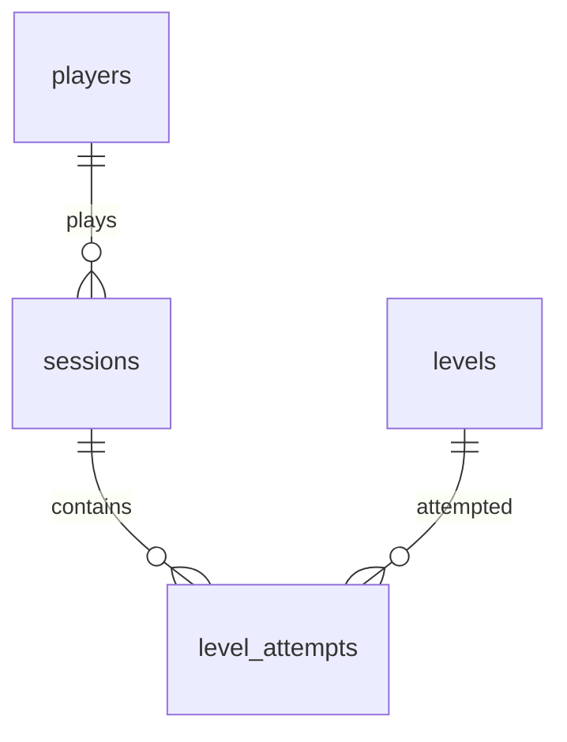

# Bảng, dòng và quan hệ
| Bảng | Cột và ý nghĩa |
|---|---|
| players | player_id khóa chính; name tên mẫu, không có thông tin cá nhân |
| sessions | session_id; player_id FK; started_at, ended_at, giây địa phương Việt Nam |
| levels | level_id; name; level_order duy nhất, tuần tự từ 1 |
| level_attempts | attempt_id; session_id, level_id FK; started_at, ended_at; result completed/failed |
| metadata | key/value: data_kind simulated, seed, version, kỳ, timezone và quy tắc |

Phiên `[start,end)` có thời lượng dương, không chồng nhau với phiên khác cùng người. Lượt thử nằm trong phiên và không chồng lượt thử cùng phiên; được thử lại màn đã qua. Màn tiếp chỉ mở sau khi màn trước hoàn thành. Phân tích chỉ tính lượt thử kết thúc đến mốc. Không lưu tổng giờ hoặc trạng thái màn hiện tại trong bảng gốc.

Đầu ra player_days: mỗi dòng một người–ngày, kèm cohort_date, session_count và session_seconds được cắt tại mốc. retention: day_offset, eligible_players, returned_players, retention_pct. cohorts thêm cohort_date/cohort_size; chưa đủ thời gian có eligible=0, returned/rate NULL. levels phân biệt attempted_players, completed_players với attempt_count, completed_attempts, failed_attempts; trung vị tính số lần thử đến thành công đầu trên người đã thành công. daily có lịch đủ ngày start→as_of, ngày vắng đếm 0.
